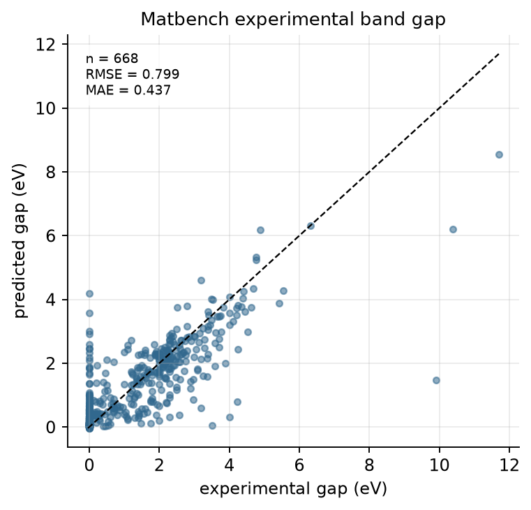

# photocat

**Language:** English · [中文](README_cn.md) · [Full English README](README_en.md)

`photocat` is a NumPy-based toolkit for two photocatalytic materials tasks:

- composition → band gap;
- TiO2 process conditions → relative hydrogen-evolution rate.

It also includes a SQLite knowledge graph, candidate ranking and
interpretability utilities. The graph/ranking workflow is validated only on a
synthetic scenario; the results below come from public experimental data.

| Benchmark | Data | Result |
| --- | --- | --- |
| Matbench experimental band gap | 3,231 / 704 / 668 compositions, element-system holdout | **RMSE 0.799 eV, MAE 0.437 eV, R² 0.696** |
| Matbench, linear ridge baseline | same | RMSE 1.218 eV, MAE 0.823 eV, R² 0.294 |
| EES photocatalytic HER | 552 records / 34 papers, leave-papers-out CV | **log R² 0.568, MAE 0.289, Spearman 0.698** |
| EES, linear ridge baseline | same | log R² 0.470, MAE 0.324, Spearman 0.586 |




## Quick start

```bash
python3 -m venv .venv
source .venv/bin/activate
pip install -e ".[dev]"

python scripts/fetch_data.py
python -m photocat bench --dataset all
python -m photocat demo --fast --out runs/scenario
python -m pytest -q
```

## Documentation

- [Full English README](README_en.md)
- [中文说明](README_cn.md)
- [Results and limits](docs/RESULTS_en.md) · [中文](docs/RESULTS_cn.md)
- [Data sources and processing](docs/DATA_en.md) · [中文](docs/DATA_cn.md)
- [Reference verification](docs/REFERENCES_en.md) · [中文](docs/REFERENCES_cn.md)
- [Algorithm notes](docs/ALGORITHM_en.md) · [中文](docs/ALGORITHM_cn.md)

## Scope

The Matbench benchmark is composition-only and uses an element-system holdout,
not the official leaderboard folds. The EES dataset is TiO2-centric and its
rate units are not fully harmonised; only relative ordering is evaluated.
Neither benchmark claims a new material discovery.

The eight references in the proposal were checked against Crossref/arXiv on
2026-11-16; see [docs/REFERENCES_en.md](docs/REFERENCES_en.md). The data hashes
and retrieval URLs are recorded in `docs/references.json` and
`data/external/SOURCES.json` and can be re-checked with
`python scripts/verify_provenance.py`.

MIT licence. The proposal PDF is [here](Photocatalytic_Materials_Discovery.pdf).
