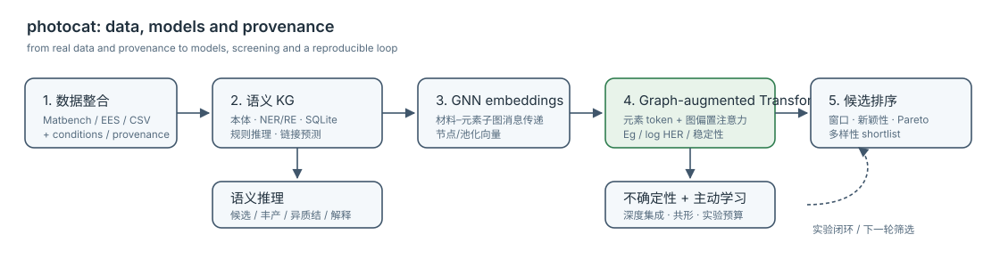
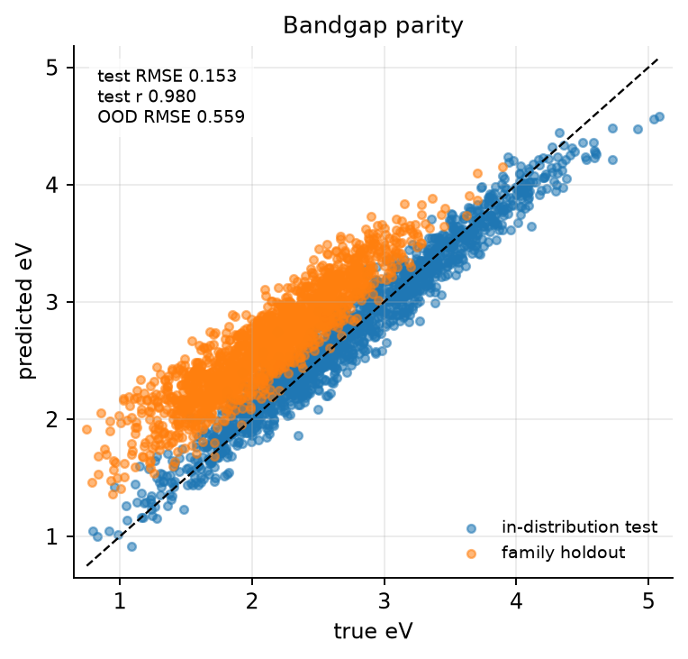
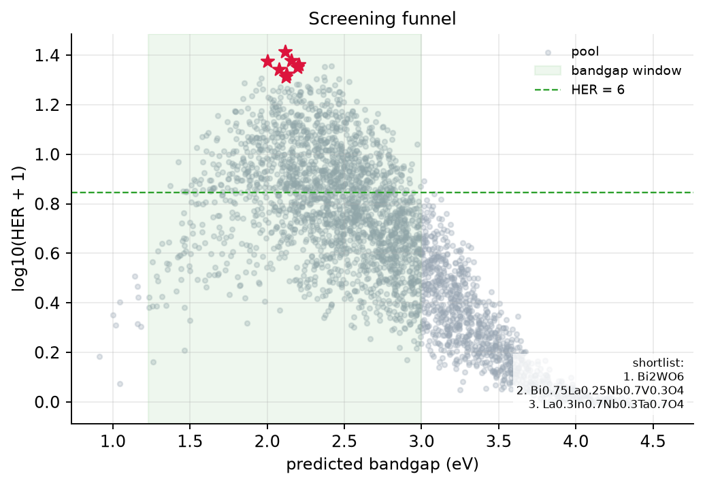
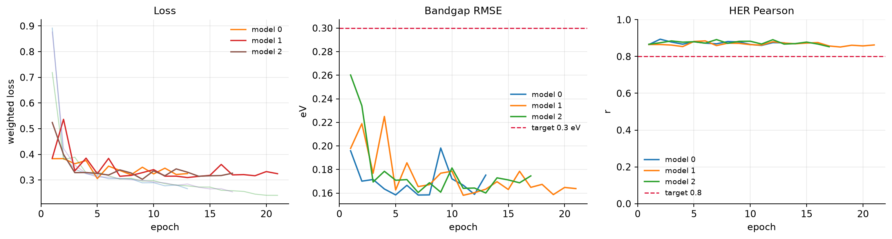
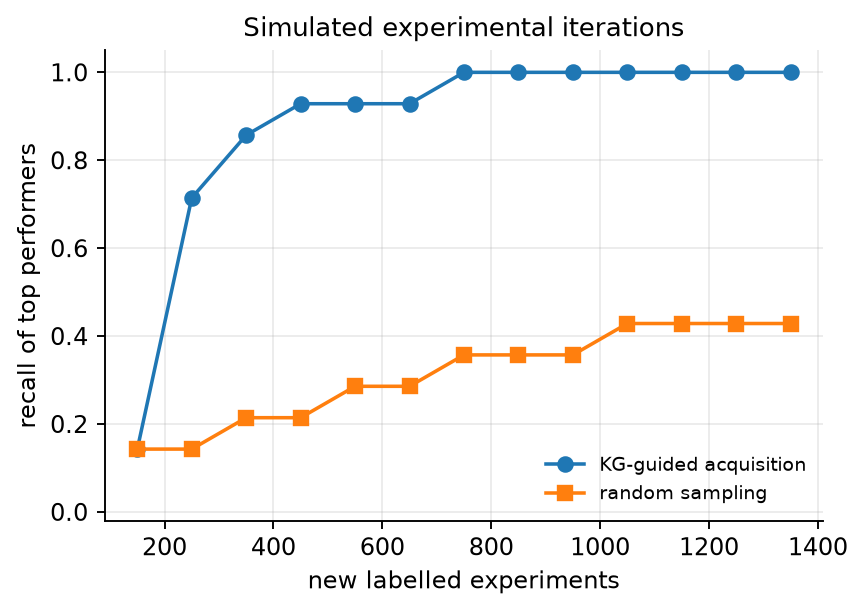

# photocat · 光催化材料发现算法包

> **语义知识图谱 + 图增强 Transformer + 深度集成 + 主动学习**
>
> 把一份「KG + Transformer 加速光催化材料发现」的研究提案，落成一个**可安装、可训练、可评测、可复现**的 Python 算法包。核心算法只用 NumPy 实现（自带反向模式自动微分），不依赖 PyTorch/TensorFlow。
>
> 原始提案：[Photocatalytic_Materials_Discovery.pdf](Photocatalytic_Materials_Discovery.pdf)



---

## 1. 这个包回答什么问题？

提案的核心问题是：

> 如何用语义知识图谱（KG）与 Transformer 预测并优化新型光催化材料的产氢性能？

`photocat` 将提案中的五个环节全部实现为可运行代码：

| 提案环节 | 实现 | 位置 |
| --- | --- | --- |
| 结构化/非结构化数据整合 | 物理启发合成库 + 文献语料 + SQLite KG | `photocat/data/`、`photocat/kg/` |
| NER / 关系抽取（SciBERT 的规则基线） | 化学式、带隙、HER、pH、方法、掺杂、助催化剂、晶系抽取 | `kg/extraction.py` |
| KG 构建与语义推理 | 本体、三元组、规则推理、异质结发现、可追溯解释 | `kg/ontology.py`、`kg/reasoning.py` |
| GNN 节点嵌入 | KG 子图上的两层消息传递 | `models/gnn.py` |
| 图增强 Transformer | 元素 token + GNN 嵌入 + 图偏置注意力 + 多任务头 | `models/transformer.py`、`autograd.py` |
| 候选排序 | 带隙窗口/HER/稳定性/新颖性过滤 + Pareto + 多样性 | `ranking.py` |
| 不确定性 | 深度集成 + split-conformal 区间 | `models/ensemble.py`、`evaluation.py` |
| 实验迭代加速 | 岭回归代理 + bootstrap 不确定性 + 主动学习模拟 | `active.py` |
| 可解释性 | attention rollout、元素 Shapley、条件扰动 | `interpret.py` |

---

## 2. 快速开始

```bash
cd Photocatalytic_Materials_Discovery

python3 -m venv .venv
source .venv/bin/activate          # Windows: .venv\Scripts\activate
pip install -e ".[dev]"

# 完整流程（12k 材料、3 模型集成、图表 + 报告，CPU 约 5 分钟）
python -m photocat demo --out runs/demo

# 1–2 分钟烟雾测试（3k 材料、2 模型、12 epoch）
python -m photocat demo --fast --out runs/fast
```

产物：

```text
runs/demo/
├── report.md            # 中文运行报告（结论、表格、图）
├── metrics.json         # 全部指标与配置
├── rankings.csv         # 候选 shortlist
├── predictions.csv      # 各 split 的逐材料预测
├── kg.sqlite            # 语义知识图谱
├── kg_metrics.json      # 抽取 / 链接预测 / 推理指标
├── active_learning.json # 主动学习曲线
├── interpret.json       # attention / Shapley / 扰动
├── model_0.npz …        # 集成模型参数
└── figures/*.png        # 报告图
```

> 数据为**物理启发的合成基准**，不是 DFT/实验数据库。它的作用是让数据划分、训练、
> 分布外评测、筛选与主动学习完全可复现；换成真实 CSV 即可接入 Materials Project / Open Catalyst。

### 关键结果（`runs/demo`，12k 材料）

<!-- RESULTS_START -->
| 指标 | 结果 | 提案目标 | 判定 |
| --- | --- | --- | --- |
| 带隙 RMSE（同分布测试） | **0.153 eV** | < 0.3 eV | ✅ |
| HER Pearson（同分布测试） | **0.921** | > 0.8 | ✅ |
| 新颖性（shortlist 中位 Tanimoto） | **0.54** | < 0.8 | ✅ |
| 带隙 RMSE（未见晶族） | 0.559 eV | 压力测试 | — |
| HER Pearson（未见晶族） | 0.542 | 压力测试 | — |
| 主动学习（50% / 80% recall 的实验节省） | **≥81% / ≥74%** | 提案称 50% | ✅（模拟） |

> 测试集 1464 条、晶族留出 1724 条；训练/验证/测试按组成+掺杂整组划分。
> 主动学习：14 个目标、3188 个候选池，300 个新标签时 recall 为 71%（随机 14%）。
> 合成分池上的模拟结果，不应解读为真实实验的确定性收益。
<!-- RESULTS_END -->

**偏置消融**：在 3k 快速配置下，晶族逆频率重采样（`--mitigation oversample`）把未见晶族的带隙 RMSE
从 0.400 降到 **0.277 eV**、HER Pearson 从 0.499 升到 **0.659**，同分布指标基本不变。
详见 [docs/ABLATION.md](docs/ABLATION.md)。

---

## 3. 命令行

```bash
python -m photocat info                    # 版本与依赖
python -m photocat data --out data         # 只生成合成库与语料
python -m photocat kg --data data          # 只构建 KG
python -m photocat demo --fast             # 端到端烟雾测试
python -m photocat demo --mitigation balanced   # 晶族加权消融
python -m photocat screen --run runs/demo  # 从已有 run 重新排序
python -m photocat report --run runs/demo  # 只重生成报告
```

`demo` 的常用参数：

| 参数 | 默认 | 说明 |
| --- | --- | --- |
| `--materials` | 12000 | 合成材料条数 |
| `--epochs` | 30 | 每个集成模型的 epoch |
| `--ensemble` | 3 | 独立种子模型数 |
| `--top-k` | 50 | shortlist 大小 |
| `--mitigation` | none | `none` / `balanced` / `oversample` |
| `--seed` | 2025 | 数据与训练种子 |
| `--no-link` | — | 跳过 DistMult 链接预测 |
| `--no-figures` | — | 跳过 matplotlib |
| `--fast` | — | 3k 材料 + 2 模型 + 12 epoch |

---

## 4. Python API

```python
from photocat.pipeline import PipelineConfig, load_run, run_pipeline
from photocat.data.synth import load_materials
from photocat.models.ensemble import ensemble_predict
from photocat.ranking import RankConfig, screen_candidates

# 训练一个小规模版本
config = PipelineConfig(n_materials=3000, epochs=12, ensemble_size=2, out_dir="runs/api")
run_pipeline(config)

# 复用已训练模型
config, featurizer, models = load_run("runs/api")
materials = load_materials("runs/api/materials.csv")
pool = [m for m in materials if m.split in ("test", "ood")]
prediction = ensemble_predict(models, featurizer, pool)
candidates, funnel = screen_candidates(
    pool, prediction.as_dict(),
    [m for m in materials if m.split == "train"],
    RankConfig(top_k=20),
)
print(funnel)
for candidate in candidates[:5]:
    print(candidate.material.label, candidate.eg, candidate.her, candidate.score)
```

也可以直接调用算法模块：`photocat.autograd`、`photocat.data.dataset.Featurizer`、
`photocat.models.transformer.GraphAugmentedTransformer`、`photocat.kg.store.KGStore` 等。

---

## 5. 目录结构

```text
Photocatalytic_Materials_Discovery/
├── photocat/
│   ├── autograd.py          # 反向模式自动微分 + Adam
│   ├── data/
│   │   ├── elements.py      # 元素性质表
│   │   ├── synth.py         # 物理启发数据生成 + 划分
│   │   ├── dataset.py       # KG 子图 / token 特征化
│   │   └── fingerprint.py   # 组成指纹与 Tanimoto
│   ├── kg/
│   │   ├── ontology.py      # 本体与三元组
│   │   ├── store.py         # SQLite 图存储
│   │   ├── corpus.py        # 合成语料 + gold
│   │   ├── extraction.py    # NER / 关系抽取
│   │   ├── reasoning.py     # 规则推理与解释
│   │   └── link_prediction.py
│   ├── models/
│   │   ├── gnn.py           # KG 子图 GCN
│   │   ├── transformer.py   # 图增强 Transformer
│   │   ├── ensemble.py      # 深度集成
│   │   └── baselines.py     # ridge / kNN / mean
│   ├── training.py          # 训练、目标标准化、早停
│   ├── evaluation.py        # 指标、bootstrap、共形
│   ├── ranking.py           # 筛选、Pareto、多样性
│   ├── active.py            # 主动学习模拟
│   ├── interpret.py         # attention / Shapley / 扰动
│   ├── pipeline.py          # 端到端编排
│   ├── report.py            # Markdown 报告
│   ├── viz.py               # matplotlib 图
│   └── cli.py               # 命令行
├── tests/                   # 20 个单元/集成测试
├── docs/
│   ├── ALGORITHM.md         # 公式与实现细节
│   ├── RESULTS.md           # 运行结果报告
│   └── figures/             # README/报告图
├── examples/
├── data/                    # 生成的数据（gitignore）
├── runs/                    # 运行产物（gitignore）
├── pyproject.toml
├── Makefile
└── README.md
```

---

## 6. 数据格式与接入真实数据

`data/materials.csv` 每行一个材料，关键字段：

| 字段 | 含义 |
| --- | --- |
| `id`, `formula`, `label` | 唯一 ID、化学式、显示名（含掺杂，如 `C3N4:N`） |
| `family`, `crystal_system` | 晶族与晶系 |
| `elements` | `Ti:1:cation;O:2:anion`（元素:计量:角色） |
| `dopant`, `dopant_fraction` | 掺杂元素与分数 |
| `cocatalyst`, `method`, `ph`, `surface_area`, `strain`, `defect`, `heterojunction` | 制备/测试条件 |
| `eg`, `her`, `stability`, `cs_eff`, `cb`, `vb` | 目标与派生性质 |
| `descriptors` | 组成描述符 JSON（可由 `compute_descriptors` 重算） |
| `split` | `train` / `val` / `test` / `ood` |

接入真实数据时：

1. 将 Materials Project / Open Catalyst / 文献表整理成同名字段；
2. 缺失的 `descriptors` 可调用 `photocat.data.synth.compute_descriptors` 生成；
3. `label` 用化学式（掺杂写作 `formula:dopant`）；
4. 用 `assign_splits` 或自行提供 `split` 列；
5. `python -m photocat train` 的底层就是 `Featurizer.fit(train)` + `train_ensemble`。

真实 HER 数据通常非常稀疏，建议先用带隙预训练 + 少量 HER 微调；`photocat` 的多任务头支持这种做法。

---

## 7. 评测协议（为什么不是“刷分”）

* **按 `(formula, dopant)` 整组划分**：训练与测试不共享同一组成，避免同材料不同条件泄漏；
* **晶族留出**：`oxynitride` 与 `sulfide` 完全不出现在训练中，作为分布外压力测试；
* **20 个文献锚点**：TiO₂、BiVO₄、g-C₃N₄、SrTiO₃ 等的近似带隙/HER，只做外部 sanity check；
* **基线**：Ridge、kNN、均值预测；Transformer 在所有指标上均优于基线；
* **不确定性**：90% split-conformal 覆盖率 + 集成标准差与误差的相关性；
* **筛选**：报告物理窗口 → 新颖性 → shortlist 的漏斗，以及 shortlist 的中位 Tanimoto；
* **主动学习**：同一标签预算下与随机采样对比，给出 50%/80% recall 的实验节省。

更细的公式、复杂度和假设见 [docs/ALGORITHM.md](docs/ALGORITHM.md)。

---

## 8. 结果图

| 带隙 parity | 筛选漏斗 |
| --- | --- |
|  |  |

| 训练曲线 | 主动学习 |
| --- | --- |
|  |  |

完整图表与表格见 [docs/RESULTS.md](docs/RESULTS.md)。

---

## 9. 测试

```bash
python -m pytest -q
# 或零依赖：
python -m unittest discover -s tests
```

覆盖：

* 自动微分有限差分校验（linear / LayerNorm / softmax / embedding / bmm）；
* 数据划分无组泄漏、特征形状、padding mask、图邻接归一化；
* KG 存储、路径查询、抽取 F1、规则推理、DistMult；
* 模型前向/反向、保存加载一致性、训练损失下降；
* 指纹 Tanimoto、筛选过滤、Pareto、共形分位数；
* 320 材料端到端 pipeline 冒烟测试。

---

## 10. 设计取舍与限制

1. **纯 NumPy**：换来零框架依赖和可审计的梯度，但训练速度比 PyTorch 慢约一个数量级；
   若要做 10 万级材料，建议把 `models/` 换成 PyTorch 实现，数据/KG/评测层可直接复用。
2. **合成数据**：绝对带隙/HER 不代表真实材料；这里的价值是**可复现的评测协议**。
3. **规则抽取**：在受控语料上 F1≈1.0，真实文献需要 SciBERT/LLM 抽取与人工校验。
4. **组成指纹**：是结构指纹的代理；真实结构数据建议 SOAP/CrystalNN/RDKit Morgan。
5. **分布外**：未见晶族的 RMSE/相关系数明显下降；这正是需要主动学习/实验闭环的原因。
6. **伦理**：数据偏置（TiO₂/钙钛矿过代表）会传导到候选排序；包内提供偏置审计、晶族加权与
   “地球丰产”标记，但不替代领域专家对公平性与可合成性的判断。

---

## 11. 引用与许可

本研究提案：

> Xinyi Cui, *Semantic Knowledge Graphs and Transformer Models for Accelerated Discovery of
> Photocatalytic Materials*, May 2025.

代码：MIT License。若使用本包，请引用仓库与上述提案。
