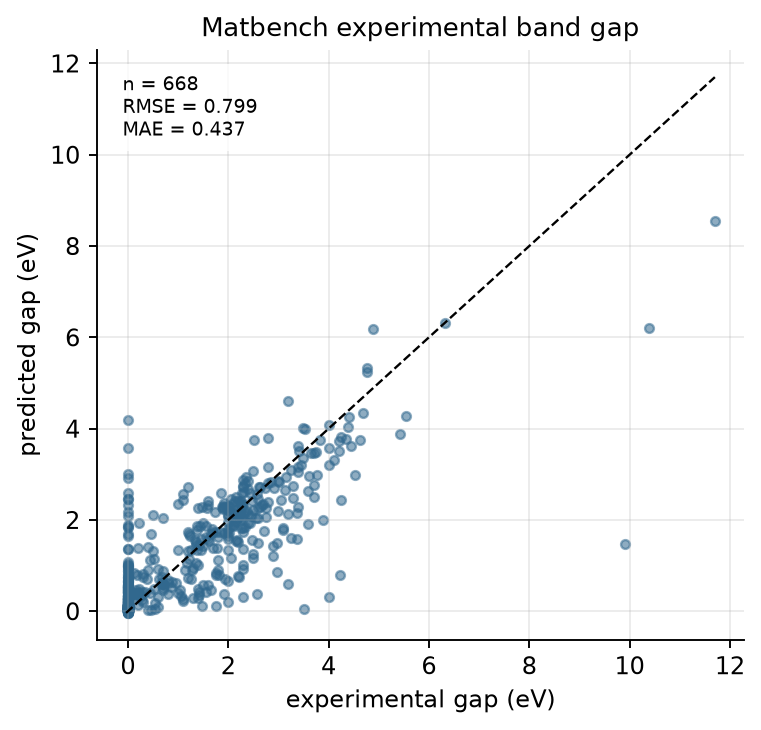
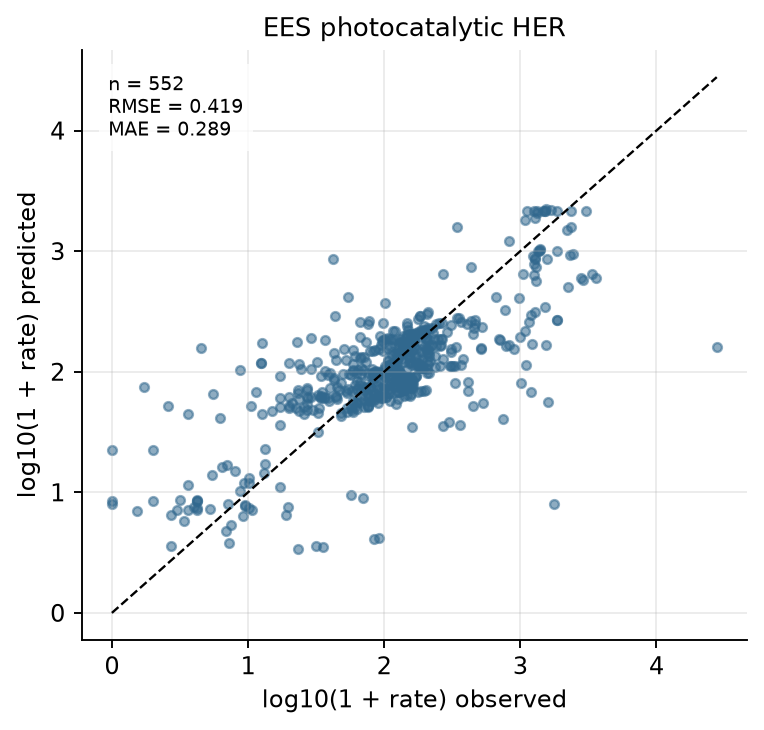
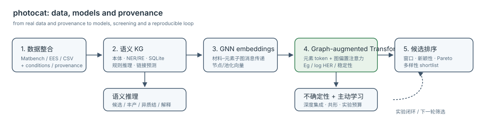

# photocat

> GitHub: https://github.com/cxy2696/photocat

**语言：** [English](README_en.md) · 中文 · [项目首页](README.md)

这是一个小型 Python 工具包，用来做光催化材料相关的两类建模：

1. **按化学组成预测带隙**：输入任意化学式，输出带隙估计；
2. **按 TiO2 工艺条件预测相对 HER**：输入助催化剂、负载量、比表面积、光强、
   牺牲剂等条件，输出对数产氢速率的相对排序。

围绕预测结果，仓库还提供一个 SQLite 知识图谱、候选筛选和可解释性模块。图谱与
排序流程目前只在合成场景上验证，作用是保证流程可运行、可追溯；它没有被当作真实
材料发现的证据。

真实数据上的结果如下，详细协议见 [docs/DATA_cn.md](docs/DATA_cn.md) 与
[docs/RESULTS_cn.md](docs/RESULTS_cn.md)。

| 基准 | 数据 | 指标 | 结果 |
| --- | --- | --- | --- |
| Matbench 实验带隙 | 3,231 / 704 / 668 组成（按元素体系留出） | RMSE / MAE / R² | **0.799 eV / 0.437 eV / 0.696** |
| 同上的线性 ridge 基线 | 同上 | RMSE / MAE / R² | 1.218 eV / 0.823 eV / 0.294 |
| 同上的 kNN 基线 | 同上 | RMSE / MAE / R² | 1.138 eV / 0.644 eV / 0.383 |
| EES 光催化 HER | 552 条记录 / 34 篇论文（按论文 5 折） | log R² / MAE / Spearman | **0.568 / 0.289 / 0.698** |
| 同上的线性 ridge 基线 | 同上 | log R² / MAE / Spearman | 0.470 / 0.324 / 0.586 |






## 安装与运行

```bash
python3 -m venv .venv
source .venv/bin/activate
pip install -e ".[dev]"

# 下载真实数据并校验哈希
python scripts/fetch_data.py

# 真实数据基准
python -m photocat bench --dataset all

# 合成场景（KG、排序、主动学习流程）
python -m photocat demo --fast --out runs/scenario

# 测试
python -m pytest -q
```

`bench` 会把结果写到 `runs/bench_gap/` 和 `runs/bench_her/`，包括
`metrics.json`、逐条预测、图和一份简短的 `report.md`。`demo` 默认生成
12,000 条合成材料；`--fast` 用 3,000 条做快速检查。

### 真实数据

Matbench `expt_gap` 是 MIT 许可的实验带隙表，37 KB，随仓库提供。EES 的
TiO2 过程表上游没有声明再分发许可证，因此只在本地下载，不进入版本库。
`scripts/fetch_data.py` 会验证两个文件的 SHA-256，并把来源写到
`data/external/SOURCES.json`。

### 模型选择

- 组成到带隙用 GNN + 图增强 Transformer。它需要从元素和计量学习，参数量约
  9 万；Matbench 上平均 2 个普通模型和 2 个 dropout=0.1 模型，CPU 训练约
  2–3 分钟。
- TiO2 过程表只有 552 条、34 篇论文。同一个 Transformer 在这类小表上会过拟合
  工艺变量；仓库改用 RBF 核岭回归（`photocat/models/kernel.py`），按论文留出
  后 log R² 为 0.568。两个模型分开报告，是因为数据形态不同，而不是为了抬高
  某一个指标。

### 可选 PyTorch 后端

组成模型提供对应的 `torch.nn` 实现，层结构与 NumPy 版本一一对应；
`load_from_numpy` 可以在两个版本之间复制权重，测试会在关闭 dropout 时检查
两者输出一致。Matbench 上 PyTorch 后端的 RMSE 为 0.801 eV、MAE 0.448 eV、
R² 0.694，处于 NumPy 版本（0.799 / 0.437 / 0.696）的正常波动范围内。
PyTorch 是可选依赖，默认路径仍是 NumPy。

```bash
pip install -e ".[torch]"
python -m photocat bench --dataset gap --backend torch --ensemble 4 --out runs/bench_gap_torch
```

## 数据和引用

- Matbench 数据：Dunn et al., *npj Comput. Mater.* **6**, 138 (2020)，
  数据 DOI [10.6084/m9.figshare.9765779](https://doi.org/10.6084/m9.figshare.9765779)；
  原始实验带隙整理自 Zhuo et al., *J. Phys. Chem. Lett.* **9**, 1668–1673 (2018)，
  DOI [10.1021/acs.jpclett.8b00124](https://doi.org/10.1021/acs.jpclett.8b00124)。
- HER 数据：Haghshenas et al., *EES Catalysis* **2**, 612–623 (2024)，
  DOI [10.1039/D3EY00246B](https://doi.org/10.1039/D3EY00246B)，
  数据仓库 [yousof96/ligh_intensity_paper](https://github.com/yousof96/ligh_intensity_paper)。

提案中的 8 条参考文献在 2026-11-16 逐条核对过，清单与 DOI 见
[docs/REFERENCES_cn.md](docs/REFERENCES_cn.md)。机器可读版本在
`docs/references.json`，运行 `python scripts/verify_provenance.py` 会重新查询
Crossref/arXiv 并校验数据哈希。

## 代码结构

```text
photocat/
├── autograd.py           # NumPy 反向模式自动微分
├── data/
│   ├── elements.py       # 手工元素表 + 生成元素表
│   ├── elements_extra.py # 63 个补充元素（pymatgen 生成）
│   ├── formula.py        # 带括号/分数计量的化学式解析
│   ├── synth.py          # 合成场景生成器
│   ├── external.py       # Matbench / EES 适配器
│   ├── dataset.py        # token、KG 子图、上下文特征
│   └── fingerprint.py    # 组成指纹与 Tanimoto
├── models/
│   ├── transformer.py    # 组成 Transformer
│   ├── gnn.py            # KG 子图消息传递
│   ├── kernel.py         # RBF 核岭回归（小表）
│   └── baselines.py      # ridge / kNN / mean
├── kg/                   # 本体、SQLite、抽取、推理、链接预测
├── benchmarks.py         # 两个真实数据基准
├── training.py           # 掩码多任务训练
├── evaluation.py         # 指标、bootstrap、共形区间
├── ranking.py            # 候选筛选与 Pareto
├── active.py             # 主动学习模拟
├── interpret.py          # attention / Shapley / 扰动
├── pipeline.py           # 合成场景编排
├── report.py             # 合成场景报告
└── cli.py
```

## 结果与限制

- Matbench 数字不是 leaderboard 成绩。官方使用固定 5 折和晶体结构输入；这里
  是元素体系留出的组成模型。
- 实验带隙混合不同测量方法，且一份组成只有一个值。RMSE 大于 MAE，说明少数
  高带隙离群点对误差贡献很大；0 eV 金属记录也保留。
- EES 的 `Rate` 列沿用作者整理值，论文之间单位并不完全统一。仓库只评估
  `log10(1 + Rate)` 的相对排序，不把绝对值当作可跨论文比较的 HER。
- 合成场景的带隙、HER、稳定性来自潜热模型，不是 DFT 或实验。此前的 20 个
  “近似文献锚点”已删除，因为无法逐条核对出处。合成场景只用于测试流程。
- 当前没有用 Materials Project、Open Catalyst 或 SciBERT 的原始数据；提案中提到
  这些来源，但仓库里每个数字都只回到 Matbench 或 EES。详见
  [docs/REFERENCES_cn.md](docs/REFERENCES_cn.md)。

## 开发

```bash
python -m pytest -q              # 32 个测试（未安装 torch 时跳过 4 个 PyTorch 测试）
python scripts/verify_provenance.py
python -m photocat info
```

默认实现是 NumPy，同时提供可选的 PyTorch 后端。12,000 条合成场景在
Apple Silicon CPU 上约 5 分钟；4,603 条 Matbench、四个模型约 2–3 分钟。
若要扩展到十万级材料，可以从 PyTorch 路径或更大的自定义模型开始，数据、KG
和评测代码保持不变。

## 许可

MIT。原始提案 PDF 在 [Photocatalytic_Materials_Discovery.pdf](Photocatalytic_Materials_Discovery.pdf)。
EOF