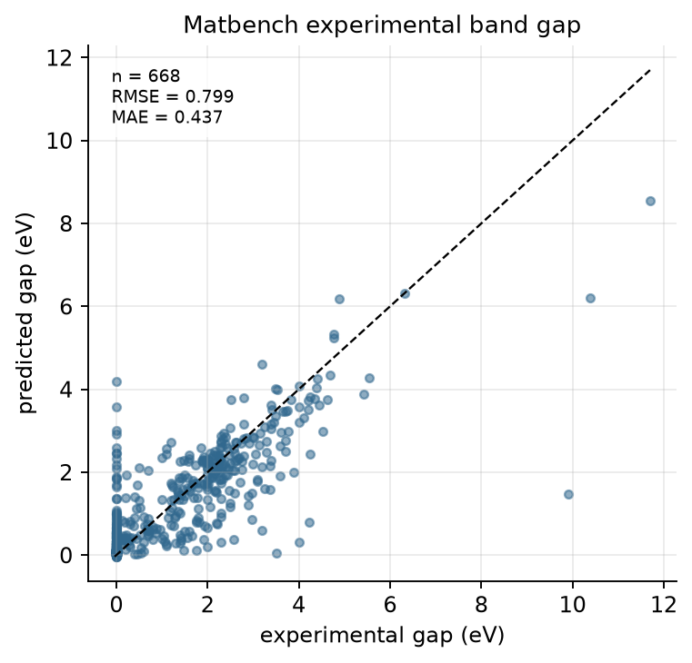
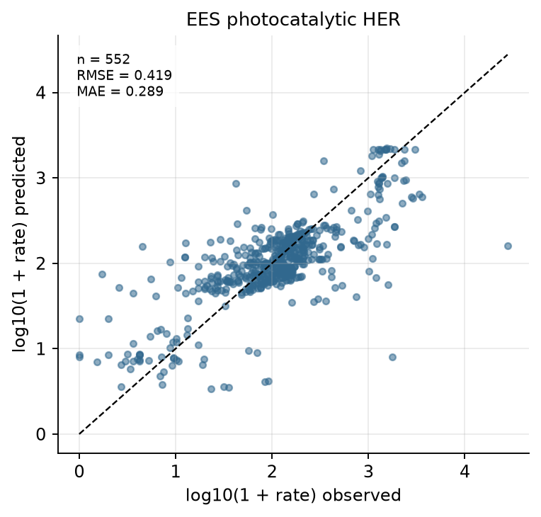
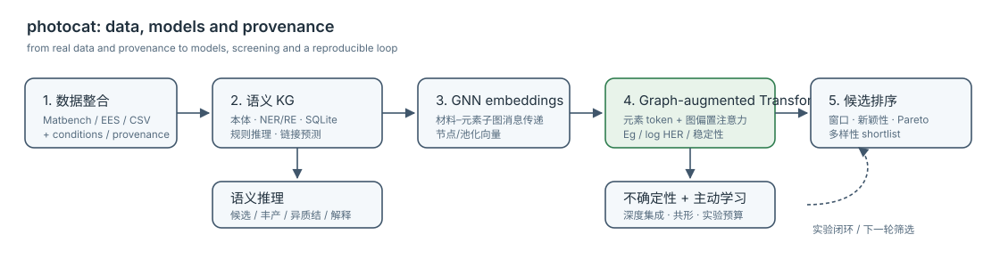

# photocat

> GitHub: https://github.com/cxy2696/photocat

**Language:** English · [中文](README_cn.md) · [Project home](README.md)

`photocat` is a small Python package for two modelling tasks in photocatalytic
materials research:

1. **Band gap from chemical composition.** The input is a formula; the output
   is an estimated band gap.
2. **Relative HER from TiO2 process conditions.** The input includes
   cocatalyst, loading, surface area, light intensity and sacrificial agent;
   the output is a relative ranking of log hydrogen-evolution rate.

The repository also contains a SQLite knowledge graph, candidate screening and
interpretability utilities. The graph and ranking pipeline is currently
validated only on a synthetic scenario, where it serves as an end-to-end
integration test. It is not presented as evidence of a real materials
discovery.

Results on the two public datasets:

| Benchmark | Data | Metrics | Result |
| --- | --- | --- | --- |
| Matbench experimental band gap | 3,231 / 704 / 668 compositions (element-system holdout) | RMSE / MAE / R² | **0.799 eV / 0.437 eV / 0.696** |
| same data, linear ridge baseline | same | RMSE / MAE / R² | 1.218 eV / 0.823 eV / 0.294 |
| same data, kNN baseline | same | RMSE / MAE / R² | 1.138 eV / 0.644 eV / 0.383 |
| EES photocatalytic HER | 552 records / 34 papers (5-fold by paper) | log R² / MAE / Spearman | **0.568 / 0.289 / 0.698** |
| same data, linear ridge baseline | same | log R² / MAE / Spearman | 0.470 / 0.324 / 0.586 |






## Install and run

```bash
python3 -m venv .venv
source .venv/bin/activate
pip install -e ".[dev]"

# download and hash-check the two external datasets
python scripts/fetch_data.py

# real-data benchmarks
python -m photocat bench --dataset all

# synthetic scenario (knowledge graph, ranking, active learning)
python -m photocat demo --fast --out runs/scenario

# tests
python -m pytest -q
```

`bench` writes `metrics.json`, per-record predictions, figures and a short
`report.md` under `runs/bench_gap/` and `runs/bench_her/`. `demo` generates
12,000 synthetic records by default; `--fast` uses 3,000.

### Real data

Matbench `expt_gap` is an MIT-licensed experimental band-gap table (37 KB) and
is included in the repository. The EES TiO2 process table has no upstream
redistribution licence, so it is downloaded locally and not committed.
`scripts/fetch_data.py` verifies the SHA-256 of both files and writes the
source details to `data/external/SOURCES.json`.

### Why two models

- The composition model is a GNN plus a graph-augmented Transformer. It has
  about 90k parameters and learns from elements and stoichiometry. Four models
  (two plain, two with dropout 0.1) are averaged on Matbench.
- The EES table has only 552 complete records from 34 papers. The same
  Transformer overfits the process variables at this size; the package uses
  RBF kernel ridge regression instead (`photocat/models/kernel.py`), which
  reaches log R² 0.568 under paper-held-out cross-validation. The two models
  are reported separately because the data regimes differ.

### Optional PyTorch backend

The composition model also has a `torch.nn` implementation. Its layers mirror
the NumPy model and `load_from_numpy` copies the weights between them; the test
suite checks numerical equivalence with dropout disabled. On Matbench the
PyTorch backend gives RMSE 0.801 eV / MAE 0.448 eV / R² 0.694, within run-to-run
variation of the NumPy result (0.799 / 0.437 / 0.696). PyTorch is optional and
the default path stays NumPy.

```bash
pip install -e ".[torch]"
python -m photocat bench --dataset gap --backend torch --ensemble 4 --out runs/bench_gap_torch
```

## Data and citations

- Matbench: Dunn et al., *npj Comput. Mater.* **6**, 138 (2020);
  data DOI [10.6084/m9.figshare.9765779](https://doi.org/10.6084/m9.figshare.9765779).
  The experimental gaps were compiled by Zhuo et al.,
  *J. Phys. Chem. Lett.* **9**, 1668–1673 (2018),
  DOI [10.1021/acs.jpclett.8b00124](https://doi.org/10.1021/acs.jpclett.8b00124).
- HER data: Haghshenas et al., *EES Catalysis* **2**, 612–623 (2024),
  DOI [10.1039/D3EY00246B](https://doi.org/10.1039/D3EY00246B);
  repository [yousof96/ligh_intensity_paper](https://github.com/yousof96/ligh_intensity_paper).

The eight references in the proposal were checked on 2026-11-16. The list and
DOIs are in [docs/REFERENCES_en.md](docs/REFERENCES_en.md); a machine-readable
copy is in `docs/references.json`. `python scripts/verify_provenance.py`
re-queries Crossref/arXiv and verifies the data hashes.

## Code layout

```text
photocat/
├── autograd.py           # reverse-mode autodiff on NumPy
├── data/
│   ├── elements.py       # hand-curated elements + generated entries
│   ├── elements_extra.py # 63 additional elements (pymatgen)
│   ├── formula.py        # formula parser with parentheses/fractions
│   ├── synth.py          # synthetic scenario generator
│   ├── external.py       # Matbench / EES adapters
│   ├── dataset.py        # tokens, KG subgraph, context features
│   └── fingerprint.py    # composition fingerprints and Tanimoto
├── models/
│   ├── transformer.py    # composition Transformer
│   ├── gnn.py            # KG-subgraph message passing
│   ├── kernel.py         # RBF kernel ridge for small tables
│   └── baselines.py      # ridge / kNN / mean
├── kg/                   # ontology, SQLite, extraction, reasoning, link prediction
├── benchmarks.py         # the two real-data benchmarks
├── training.py           # masked multi-task training
├── evaluation.py         # metrics, bootstrap, conformal intervals
├── ranking.py            # candidate filtering and Pareto front
├── active.py             # active-learning simulation
├── interpret.py          # attention, Shapley, ablations
├── pipeline.py           # synthetic scenario orchestration
├── report.py             # synthetic scenario report
└── cli.py
```

## Results and limitations

- The Matbench number is not a leaderboard entry. The official benchmark uses
  fixed folds and crystal-structure inputs; this is a composition-only model
  with element-system holdout.
- Experimental band gaps mix measurement methods and assign one value per
  composition. RMSE is larger than MAE because a few high-gap outliers dominate
  the squared error; 0 eV metal records are retained.
- The EES `Rate` column follows the authors' table. Units are not fully
  harmonised across papers. The repository evaluates the relative ordering of
  `log10(1 + Rate)`, not an absolute HER that can be compared across papers.
- The synthetic scenario's band gap, HER and stability come from a latent
  model, not from DFT or experiment. The previous 20 “literature anchors” were
  removed because they could not be traced record by record. The scenario is
  used only to exercise the workflow.
- The repository does not use raw Materials Project, Open Catalyst or SciBERT
  data. Those sources appear in the proposal discussion; every number here goes
  back to Matbench or EES. See [docs/REFERENCES_en.md](docs/REFERENCES_en.md).

## Development

```bash
python -m pytest -q              # 32 tests (4 PyTorch tests are skipped if torch is absent)
python scripts/verify_provenance.py
python -m photocat info
```

The default implementation is NumPy; an optional PyTorch backend mirrors the
composition model. A 12,000-record synthetic run takes about 5 minutes on an
Apple Silicon CPU; the four-model Matbench run takes about 2–3 minutes. For
100k-scale datasets, the PyTorch path (or a larger custom model) is the
sensible starting point, while the data, KG and evaluation layers stay the
same.

## Licence

MIT. The original proposal PDF is at
[Photocatalytic_Materials_Discovery.pdf](Photocatalytic_Materials_Discovery.pdf).
