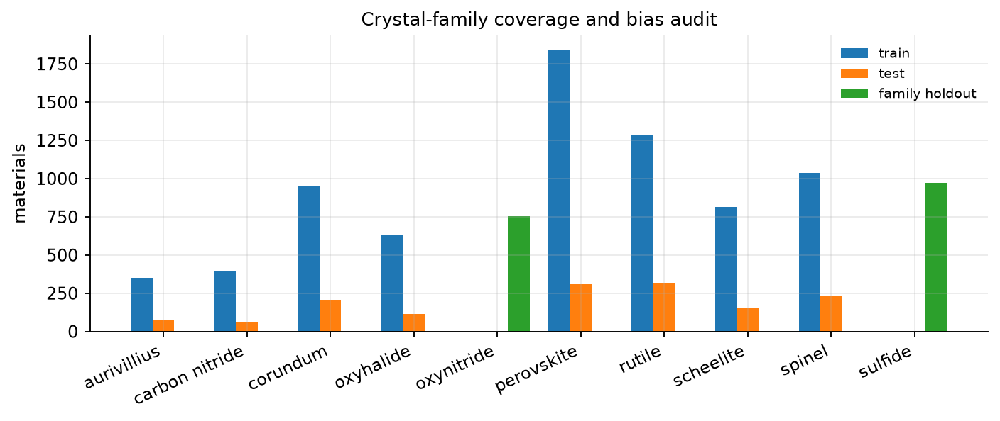
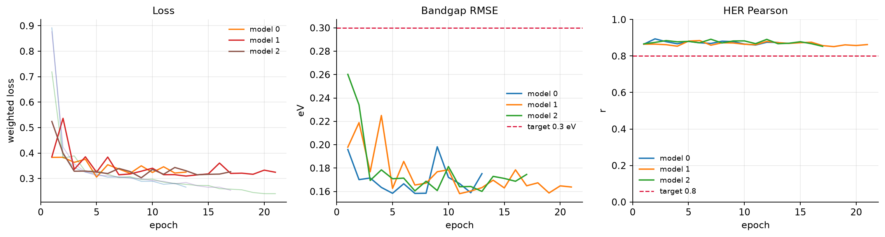
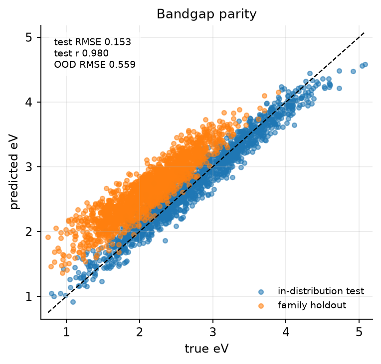
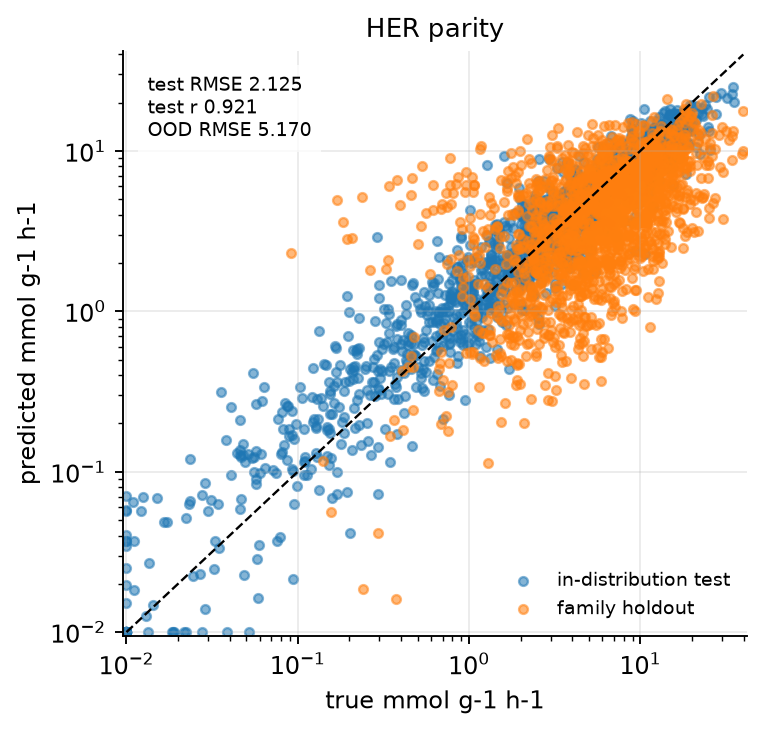
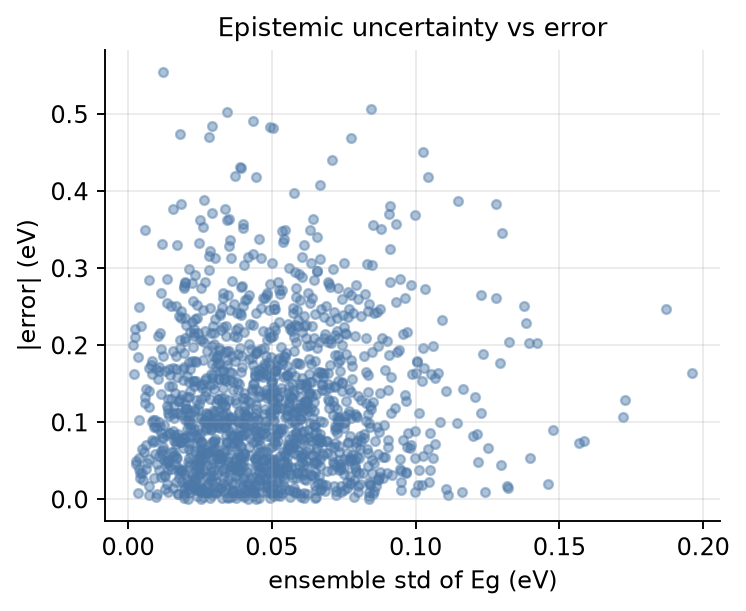
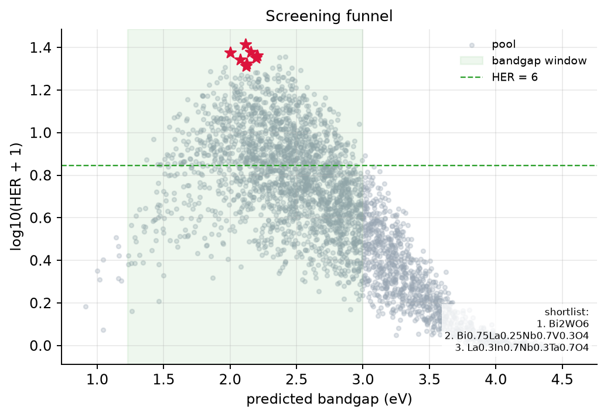
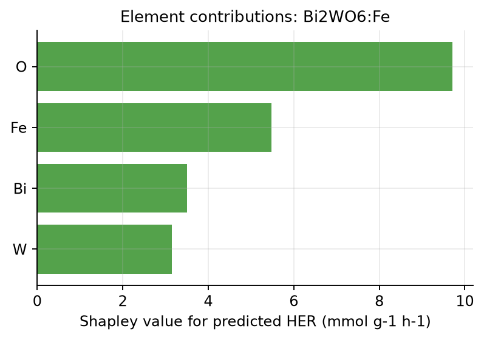
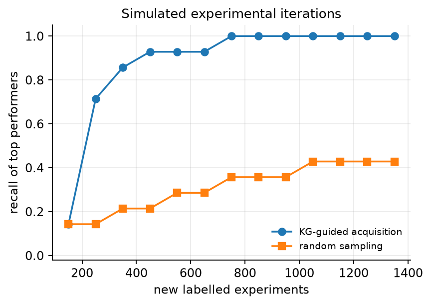
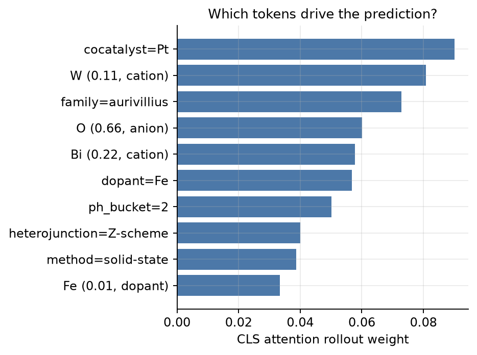

# 运行结果（runs/demo）

> 本文件由 `runs/demo/report.md` 归档，方便在文档中直接阅读。重新运行 `python -m photocat demo` 后可用 `python scripts/update_docs.py` 刷新。

# 光催化材料发现：KG + 图增强 Transformer 运行报告

> 自动生成于 2026-11-16 21:18。数据为**物理启发的合成基准**（非 DFT/实验数据库），目标是为算法提供可复现的验证环境。

## 0. 结论摘要

| 指标 | 结果 | 目标 | 判定 |
| --- | --- | --- | --- |
| 带隙 RMSE（同分布测试集） | 0.153 eV | < 0.3 eV | ✅ |
| HER Pearson（同分布测试集） | 0.921 | > 0.8 | ✅ |
| 新颖性（shortlist 中位 Tanimoto） | 0.541 | < 0.8 | ✅ |
| 家族留出带隙 RMSE | 0.559 eV | 压力测试 | — |
| 家族留出 HER Pearson | 0.542 | 压力测试 | — |

核心结论：模型在同分布测试集上达到论文设定的带隙与 HER 指标；在完全未见的晶族上性能下降，说明分布外泛化仍是主要限制。KG 提供可追溯的筛选与解释，主动学习模拟显示可用更少的实验标签找到头部材料。

## 1. 数据与评测协议

| 项目 | 数值 |
| --- | --- |
| 材料总数 | 12000 |
| 训练 / 验证 / 测试 | 7305 / 1507 / 1464 |
| 晶族留出 | 1724 |
| 留出晶族 | oxynitride, sulfide |
| 候选比例（真实标签） | 0.293 |

**Split 设计**：按“化学式 + 掺杂元素”整组划分，训练/测试不共享同一组成；`oxynitride` 与 `sulfide` 两个晶族完全留出作为分布外压力测试。锚点集为 20 个文献光催化剂的近似带隙/HER，仅用于外部 sanity check。






## 2. 模型与训练

| 模型 | 参数量 | 最佳 epoch | 训练秒数 | 验证损失 |
| --- | --- | --- | --- | --- |
| model 0 | 89419 | 5 | 56.18 | 0.3058 |
| model 1 | 89419 | 13 | 96.02 | 0.3096 |
| model 2 | 89419 | 9 | 72.05 | 0.3030 |

- 架构：GNN（KG 子图消息传递）+ 2 层 graph-augmented Transformer，d_model=64，4 头；深度集成 3 个种子。
- 损失：带隙 MSE + log1p(HER) MSE + 0.25 × 稳定性 BCE；AdamW + cosine decay + early stopping。
- 偏置缓解策略：`none`。

## 3. 主结果

| Split | n | Eg RMSE (eV) | Eg MAE | Eg R² | HER Pearson | HER RMSE | 稳定性 MAE |
| --- | --- | --- | --- | --- | --- | --- | --- |
| 训练 | 7305 | 0.136 | 0.108 | 0.961 | 0.930 | 1.94 | 0.059 |
| 验证 | 1507 | 0.150 | 0.119 | 0.954 | 0.923 | 1.98 | 0.061 |
| 同分布测试 | 1464 | 0.153 | 0.121 | 0.959 | 0.921 | 2.12 | 0.062 |
| 晶族留出 | 1724 | 0.559 | 0.524 | -0.304 | 0.542 | 5.17 | 0.313 |
| 文献锚点 | 20 | 0.418 | 0.327 | 0.497 | -0.135 | 4.48 | 0.099 |

同分布测试集带隙 RMSE 的 90% bootstrap 置信区间：[0.147, 0.158] eV；HER Pearson 的 90% 区间：[0.909, 0.932]。






### 3.1 与基线对比（同分布测试集）

| 模型 | 测试 Eg RMSE | 测试 HER r | OOD Eg RMSE | OOD HER r |
| --- | --- | --- | --- | --- |
| ridge | 0.283 | 0.665 | 1.667 | -0.132 |
| knn | 0.380 | 0.727 | 0.801 | 0.013 |
| mean | 0.753 | 0.000 | 0.764 | 0.000 |
| KG + transformer | 0.153 | 0.921 | 0.559 | 0.542 |

## 4. 不确定性与共形预测

在验证集上校准 90% split-conformal 区间：带隙半宽 0.248 eV，log-HER 半宽 0.452。

| Split | Eg 覆盖率 | Eg 区间宽度 | HER(log) 覆盖率 |
| --- | --- | --- | --- |
| test | 0.900 | 0.497 | 0.899 |
| ood | 0.068 | 0.497 | 0.490 |

集成标准差与绝对误差的 Spearman 相关：Eg 0.058，log-HER 0.274。共形区间在同分布测试集覆盖 0.900，留出晶族仅 0.068：这既是分布外风险的信号，也说明小集成对带隙的 epistemic uncertainty 估计偏弱；实际筛选应以共形区间与集成共识共同判断，而不是只看方差。




## 5. 语义知识图谱

| 实体 | 三元组 | 材料 | 关系类型 |
| --- | --- | --- | --- |
| 12095 | 215396 | 12020 | 23 |

### 5.1 文献抽取（合成语料，规则抽取器）

| 任务 | Precision | Recall | F1 | TP / FP / FN |
| --- | --- | --- | --- | --- |
| 关系三元组 | 0.999 | 1.000 | 1.000 | 1614.0 / 1.0 / 0.0 |
| 实体提及 | 1.000 | 1.000 | 1.000 | 2234.0 / 1.0 / 0.0 |

### 5.2 链接预测（DistMult）

| MRR | Hits@1 | Hits@10 | 全实体采样 MRR |
| --- | --- | --- | --- |
| 0.384 | 0.126 | 1.000 | 0.078 |

### 5.3 规则推理

候选材料 3519 个，其中地球丰产 1809 个、新颖 1103 个；发现 20 对 type-II 异质结候选。推理结果以带来源的三元组物化，可逐条追溯。

| 材料 A | 材料 B | Eg A | Eg B | 共同元素 |
| --- | --- | --- | --- | --- |
| Bi0.25In0.75VO4:Fe | BaNb0.5Ta0.5O2N:N | 2.15 | 1.98 | O |
| Bi0.25In0.75VO4:Fe | CaNbO2N | 2.15 | 2.07 | O |
| Bi0.25In0.75VO4:Fe | Ce0.25La0.75Nb0.5V0.5O4:N | 2.15 | 2.27 | O, V |
| Bi0.25In0.75VO4:Fe | BaTa0.5Nb0.5O2N:Fe | 2.15 | 2.20 | Fe, O |
| Bi0.25In0.75VO4:Fe | Bi2WO6:Fe | 2.15 | 2.13 | Bi, Fe, O |
| Bi0.25In0.75VO4:Fe | La0.3In0.7Nb0.3Ta0.7O4:C | 2.15 | 1.93 | In, O |
| Bi0.25In0.75VO4:Fe | SrNbO2N:Fe | 2.15 | 2.20 | Fe, O |
| Bi0.25In0.75VO4:Fe | Bi2WO6 | 2.15 | 2.07 | Bi, O |

### 5.4 候选解释示例

```text
### Bi0.25In0.75VO4:Fe

Bi0.25In0.75VO4:Fe (scheelite) has Eg = 2.15 eV, HER = 45.50 mmol g-1 h-1 and stability 0.78; CB/VB = -0.17/1.98 eV vs NHE at pH 9.0.

- inferred **inferred:Candidate** (rule:candidate)
- inferred **inferred:HeterojunctionWith** × 20 (pc-000003, pc-001383, pc-002105, pc-002847 …)

Evidence:
- `hasBandgap` → 2.152 = 2.151831339654885 eV
- `hasChargeSeparation` → 0.863 = 0.8630879084728001 probability
- `hasCoCatalyst` → cocatalyst:MoS2
- `hasConductionBand` → -0.168 = -0.16759305433148253 eV vs NHE
- `hasCrystalSystem` → crystal_system:tetragonal
- `hasDopant` → dopant:Fe = 0.06121767529028184 fraction
- `hasElement` → element:Bi = 0.041245837617608264 fraction
- `hasElement` → element:Fe = 0.010099897177401737 fraction
- `hasElement` → element:In = 0.12373751285282479 fraction
- `hasElement` → element:O = 0.6599334018817322 fraction
- `hasElement` → element:V = 0.16498335047043305 fraction
- `hasFamily` → family:scheelite
- `hasHER` → 45.499 = 45.498863210710624 mmol g-1 h-1
- `hasStability` → 0.779 = 0.7791735204190023 probability
- `hasSynthesisMethod` → method:CVD
- `hasValenceBand` → 1.984 = 1.9842382853234026 eV vs NHE
- `operatesAtPH` → 9.0 = 9.0 pH
- `reportedIn` → dataset:synthetic_library_v1
- `usedFor` → application:hydrogen_evolution

Type-II partners: pc-000003, pc-001383, pc-002105
```

## 6. 候选筛选

| 阶段 | 数量 |
| --- | --- |
| 候选池 | 3188.0 |
| 通过物理窗口 | 987.0 |
| 通过新颖性 (< 0.8) | 908.0 |
| 最终 shortlist | 50.0 |
| Pareto 前沿 | 91.0 |




| # | 材料 | 晶族 | Eg (eV) | HER | 稳定性 | Tanimoto | score |
| --- | --- | --- | --- | --- | --- | --- | --- |
| 1 | Bi2WO6:Fe | aurivillius | 2.12 | 24.89 | 0.78 | 0.62 | 1.819 |
| 2 | Bi0.75La0.25Nb0.7V0.3O4:Fe | scheelite | 2.16 | 22.91 | 0.79 | 0.70 | 1.672 |
| 3 | La0.3In0.7Nb0.3Ta0.7O4:C | scheelite | 2.00 | 22.76 | 0.75 | 0.71 | 1.659 |
| 4 | CaTa0.25Nb0.75O2N:Fe | oxynitride | 2.21 | 21.97 | 0.75 | 0.40 | 1.643 |
| 5 | LaTiO2N:C | oxynitride | 2.08 | 20.98 | 0.67 | 0.33 | 1.596 |
| 6 | Bi2WO6:P | aurivillius | 2.19 | 21.37 | 0.78 | 0.65 | 1.567 |
| 7 | C3N4:N | carbon_nitride | 2.12 | 20.07 | 0.84 | 0.53 | 1.523 |
| 8 | BaNbO2N:P | oxynitride | 2.12 | 19.51 | 0.65 | 0.36 | 1.488 |
| 9 | LaTiO2N:S | oxynitride | 2.37 | 19.51 | 0.75 | 0.29 | 1.482 |
| 10 | CuInS2:Fe | sulfide | 2.21 | 18.12 | 0.79 | 0.23 | 1.386 |




## 7. 主动学习：需要多少实验？

| 指标 | 数值 |
| --- | --- |
| 目标材料数（HER top 1%） | 14 |
| 初始标签 | 150 |
| 达到 50% recall 所需新标签（主动 / 随机） | 250 / — |
| 50% recall 的实验节省 | ≥0.81 |
| 达到 80% recall 所需新标签（主动 / 随机） | 350 / — |
| 80% recall 的实验节省 | ≥0.74 |
| 最终 recall（主动 / 随机） | 1.000 / 0.429 |
| 300 个新标签时 recall（主动 / 随机） | 0.714 / 0.143 |

随机采样在测试预算内未达到 50% recall；节省列为保守下界。




## 8. 可解释性

- `cocatalyst=Pt`：0.090
- `W (0.11, cation)`：0.081
- `family=aurivillius`：0.073
- `O (0.66, anion)`：0.060
- `Bi (0.22, cation)`：0.058
- `dopant=Fe`：0.057
- `ph_bucket=2`：0.050
- `heterojunction=Z-scheme`：0.040




| 扰动字段 | Δlog-HER RMSE | 扰动后 RMSE |
| --- | --- | --- |
| cocatalyst | 0.112 | 0.386 |
| ph | 0.108 | 0.381 |
| surface_area | 0.062 | 0.335 |
| heterojunction | 0.003 | 0.277 |
| method | -0.001 | 0.273 |

**元素 Shapley（Bi2WO6:Fe，目标 HER）**：O 9.71；Fe 5.48；Bi 3.51；W 3.14。

## 9. 复现

```bash
python -m photocat demo --materials 12000 --epochs 30 --ensemble 3 --out runs/demo
```

完整算法与公式见 `docs/ALGORITHM.md`；接口与目录见 `README.md`。

## 10. 限制

- 数据由潜热模型生成，带隙/HER 的绝对数值不代表真实材料；本报告验证的是**算法流程与评测协议**，接真实 Materials Project / Open Catalyst / 文献数据时只需替换 CSV 与语料。
- 晶族留出的性能下降表明，面对全新化学空间时需要主动学习/实验闭环，而不能只依赖离线模型。
- 规则抽取器在受控合成语料上接近满分，真实文献需要 SciBERT/LLM 抽取与人工校验。
- 新颖性使用组成指纹近似 Tanimoto；真实场景应使用结构指纹（SOAP、CrystalNN）或 RDKit Morgan。
