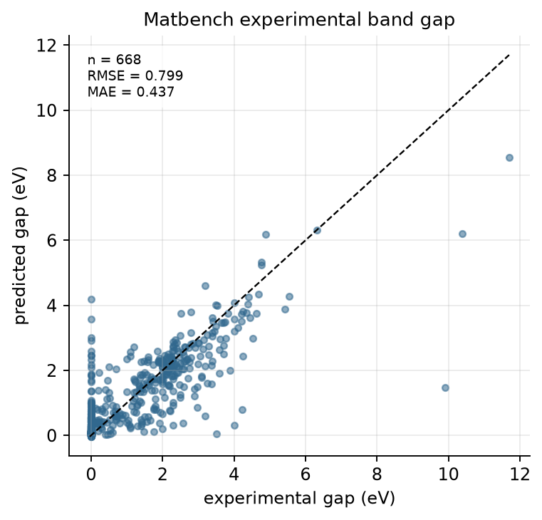
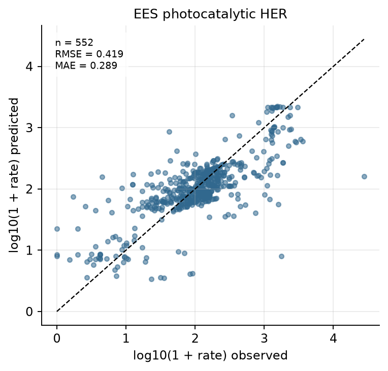

# 结果

[English](RESULTS_en.md) · 中文

本页只汇总**真实数据**上的结果。合成场景的报告由 `python -m photocat demo`
生成到 `runs/<name>/report.md`，不作为验证证据。

复现命令：

```bash
python scripts/fetch_data.py
python -m photocat bench --dataset all --epochs 24 --ensemble 4 --seed 2025
```

---

## 1. Matbench 实验带隙

**协议**：4,603 条实验带隙；按元素体系留出，3,231 训练 / 704 验证 / 668
测试。输入只有化学式，没有任何晶体结构或条件信息。模型为 KG 子图 GNN +
两层图增强 Transformer（d_model=64，4 头，2 个普通模型 + 2 个 dropout=0.1 模型）。

| 模型 | RMSE (eV) | MAE (eV) | R² |
| --- | ---: | ---: | ---: |
| 均值 | 1.449 | 1.155 | 0.000 |
| kNN（k=10） | 1.138 | 0.644 | 0.383 |
| 组成特征 ridge | 1.218 | 0.823 | 0.294 |
| **GNN + Transformer（2 普通 + 2 dropout）** | **0.799** | **0.437** | **0.696** |

- 90% bootstrap 区间（RMSE）：[0.666, 0.945] eV。
- 90% split-conformal 半宽 2.182 eV，测试覆盖率 0.894。区间很宽，原因是实验
  带隙表尾部有若干 10 eV 以上的离群值；这个区间适合作为“不要过度相信单点预测”
  的提醒。
- 模型在 10 eV 以上的高带隙区明显低估，在 0 eV 附近高估。组成模型没有结构信息，
  这类误差是预期内的。



可选 PyTorch 后端（`--backend torch`，四个模型、同一划分）得到 RMSE 0.801 eV、
MAE 0.448 eV、R² 0.694，与 NumPy 结果一致。

**能说明什么**：在完全未见的元素体系上，组成 Transformer 的误差显著低于组成
特征 ridge 和 kNN，说明元素/计量表示确实提供了可迁移信息。

**不能说明什么**：这不是 Matbench 官方榜单成绩（官方固定 5 折且结构模型参与），
也不能据此声称能预测光催化性能。实验带隙混合了不同测量方法。

---

## 2. EES 光催化 HER

**协议**：EES Catalysis 2024 的 TiO2 过程表。原始 920 行/52 篇论文，删除
`Rate`、`SA`、`LI`、`BG` 有缺失的行后剩 552 行/34 篇。按论文做 5 折交叉验证，
测试折论文不参与训练。目标 `log10(1 + Rate)`。

| 模型 | R² | MAE | Spearman |
| --- | ---: | ---: | ---: |
| 均值 | 0.000 | 0.453 | 0.000 |
| 线性 ridge | 0.470 | 0.324 | 0.586 |
| **RBF 核岭回归** | **0.568** | **0.289** | **0.698** |

- RBF 核参数固定为 `gamma=0.03`、`alpha=0.1`，在 5 折上一次性评估，没有在
  测试折上调参。
- 线性模型与核模型使用相同的特征和折划分，差异来自非线性。
- 这里的 `Rate` 沿用作者表数值。不同论文单位不完全统一，因此结果只用于相对
  排序；绝对 HER 需要回到原始论文核对单位。



**能说明什么**：在只有 552 条记录、34 篇论文的小表上，合适的模型（核岭回归）
可以从助催化剂、负载量、比表面积、光强和牺牲剂中获得可用的相对排序。

**不能说明什么**：数据几乎全是 TiO2 体系，不能外推到其他材料家族；也不能把
预测值直接当成 mmol g⁻¹ h⁻¹ 的绝对值。

---

## 3. 合成场景

`python -m photocat demo` 仍会训练同样的组成 Transformer，并在合成的 12,000
条材料上跑 KG、候选排序、共形区间和主动学习。它用来检查整条流程能否连通、
结果文件是否完整，以及排序/KG 接口是否可用。

这些数字（带隙 RMSE、HER 相关系数、候选新颖性、主动学习节省）**不是**真实
材料数据上的验证结果，不在本页列出。此前的“20 个文献锚点”已删除；合成场景
不再使用任何近似文献值。

---

## 4. 复现环境

- Python 3.13，NumPy 2.2，Apple Silicon CPU。
- Matbench 基准：2 个模型 × 24 epoch，约 1.5 分钟。
- EES 基准：5 折核岭回归，约 1 秒。
- 随机种子 2025；数据划分、模型初始化、bootstrap 和折划分均由种子控制。
