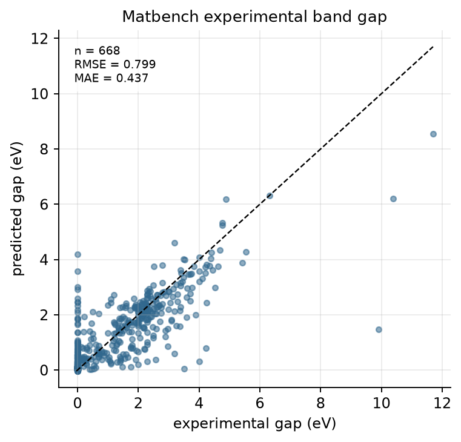
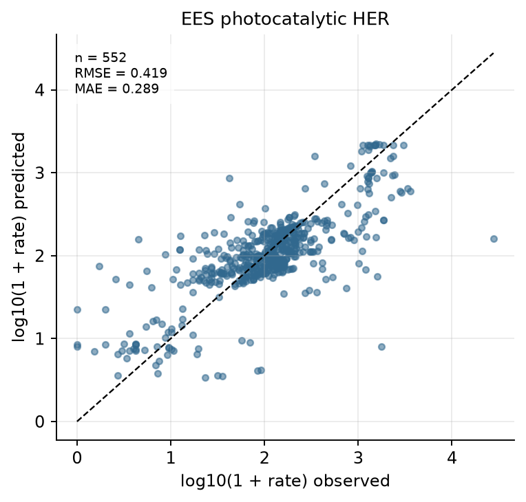

# Results

[English](RESULTS_en.md) · [中文](RESULTS_cn.md)

This page reports **real-data** results only. The synthetic scenario is a
workflow test; its report is written to `runs/<name>/report.md` and is not used
as evidence.

Reproduce with:

```bash
python scripts/fetch_data.py
python -m photocat bench --dataset all --epochs 24 --ensemble 4 --seed 2025
```

---

## 1. Matbench experimental band gap

**Protocol.** 4,603 experimental gaps, split by element system: 3,231 train /
704 validation / 668 test. The input is the chemical formula only; no crystal
structure or conditions. The model is a KG-subgraph GNN plus a two-layer
graph-augmented Transformer (d_model=64, 4 heads) with a mixed ensemble of two
plain models and two models using dropout 0.1.

| Model | RMSE (eV) | MAE (eV) | R² |
| --- | ---: | ---: | ---: |
| mean predictor | 1.449 | 1.155 | 0.000 |
| kNN (k=10) | 1.138 | 0.644 | 0.383 |
| composition-feature ridge | 1.218 | 0.823 | 0.294 |
| **GNN + Transformer (2 plain + 2 dropout)** | **0.799** | **0.437** | **0.696** |

- 90% bootstrap interval for RMSE: [0.666, 0.945] eV.
- 90% split-conformal half-width: 2.182 eV; test coverage 0.894. The interval is
  wide because a few experimental gaps above 10 eV dominate the tail; it should
  be read as a warning against over-trusting a single prediction.
- The model underestimates gaps above about 10 eV and overestimates near 0 eV.
  This is expected for a composition-only model without structure.



The optional PyTorch backend (`--backend torch`, four models, same split) gives
RMSE 0.801 eV / MAE 0.448 eV / R² 0.694, consistent with the NumPy result.

**What this supports.** On unseen element systems, the composition Transformer
has clearly lower error than composition ridge and kNN. The element and
stoichiometry representation carries transferable information.

**What this does not support.** It is not a Matbench leaderboard entry: the
official benchmark uses fixed folds and structure-aware models. It is also not
a photocatalytic performance claim. Experimental gaps mix measurement methods
and keep one value per composition.

---

## 2. EES photocatalytic HER

**Protocol.** The EES Catalysis 2024 TiO2 process table. Of 920 rows from 52
papers, 552 rows from 34 papers have complete `Rate`, `SA`, `LI` and `BG`.
Leave-papers-out 5-fold cross-validation; the target is `log10(1 + Rate)`.

| Model | R² | MAE | Spearman |
| --- | ---: | ---: | ---: |
| mean predictor | 0.000 | 0.453 | 0.000 |
| linear ridge | 0.470 | 0.324 | 0.586 |
| **RBF kernel ridge** | **0.568** | **0.289** | **0.698** |

- The kernel uses fixed `gamma=0.03`, `alpha=0.1`; it is evaluated once on the
  five folds, with no tuning on the test folds.
- The linear and kernel models use the same features and folds; the difference
  is non-linearity.
- The `Rate` column follows the authors' table. Units are not fully harmonised
  across papers, so only relative ordering is evaluated. Absolute HER requires
  returning to the original papers.



**What this supports.** With 552 records and 34 papers, a small kernel model
can learn a useful relative ordering from cocatalyst, loading, surface area,
light intensity and sacrificial agent.

**What this does not support.** The table is almost entirely TiO2; it does not
generalise to other material families. Predicted values are not
mmol g⁻¹ h⁻¹ values that can be compared across papers.

---

## 3. Synthetic scenario

`python -m photocat demo` still trains the composition Transformer on 12,000
synthetic records and exercises the KG, ranking, conformal intervals and
active-learning loop. It checks that the workflow runs and that artifacts are
written. Its numbers (band-gap RMSE, HER correlation, candidate novelty,
active-learning savings) are **not** real-data validation and are not reported
here. The previous 20 “literature anchors” have been removed; the scenario no
longer uses approximate literature values.

---

## 4. Environment

- Python 3.13, NumPy 2.2, Apple Silicon CPU.
- Matbench: four models × 24 epochs, about 2–3 minutes.
- EES: five-fold kernel ridge, about one second.
- Random seed 2025; data splits, initialisation, bootstrap and folds are
  controlled by seeds.
